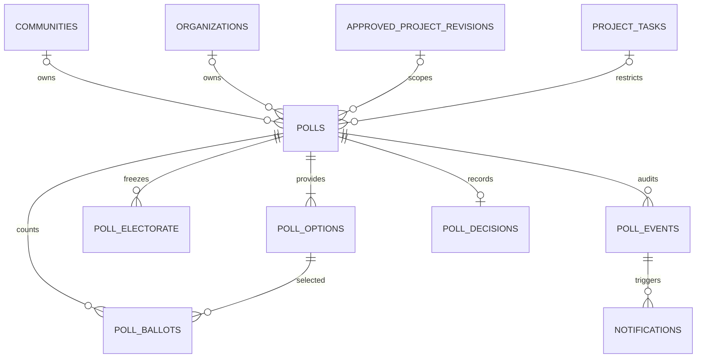

# Ayinou master database plan

**Status:** Forward-looking architecture. Twenty-eight application tables are deployed through Phase 2E, including the private account, institutional, affiliation, and administration tables. This plan uses the database blueprint, product and roadmap documents, and the hosted AyiNou project (`hcbxulyfmdmuyccgrujs`).

## Verified baseline and design rules

Hosted migration history runs from `20261119160000_initial_schema` through `20261120132000_phase4a_department_moderation`. Guarded hosted checks cover profile behavior and saved languages, TOTP, institutions, affiliations, feed engagement, following, recommendations, post images, notifications, member safety, appeals, and the ten department spaces. Delivered confirmation and recovery mail and natural token expiry remain unverified.

`auth.users` remains the identity source. Web, Android, and iOS use Supabase Auth to obtain tokens, then use the independent versioned Fastify API for application actions. Fastify validates tokens, checks domain authorization, and uses caller-scoped database access under RLS; privileged service operations are narrow, audited, and server-only. No application table stores passwords, raw identity documents, payment-card details, or precise household coordinates. Preserve user-generated content in its original language and label any future translations. Apply future changes as additive versioned migrations with grants, RLS, indexes, rollback/compatibility review, and allow/deny tests. Never edit applied migration files or reset hosted data.

### Catalog notation

Every column is listed below; `PK` means primary key, `FK→` names a referenced column, `UQ` means unique constraint, and `IX(...)` means a proposed index (the PK/UQ already supply their own indexes). `id uuid PK` means `DEFAULT gen_random_uuid()`. `ca timestamptz` means `created_at timestamptz NOT NULL DEFAULT now()`; `ua timestamptz` means `updated_at timestamptz NOT NULL DEFAULT now()` with a trigger. Other `timestamptz` columns are nullable unless marked `!`. `!` means NOT NULL; `?` means nullable. All proposed status/kind/locale values need named CHECK constraints or stable reference tables; examples below are controlled values, not client-writable free text. Every FK needs an explicit `ON DELETE` choice during migration review; default to `RESTRICT` for audit/financial history, `CASCADE` for pure membership/joins, and `SET NULL` for optional actors. Do not cascade-delete evidence or audit history without retention review.

## Existing schema — applied contract

Phase 2B adds `member_private.first_name`, `last_name`, `membership_category`, and `onboarding_step`, plus `profiles.username`, `biography`, and `avatar_asset`. The `member-avatars` bucket stores only sanitized private derivatives. The exact definitions are in `20261119220000_phase2b_membership.sql`.

| Table | Fields and keys | Access |
| --- | --- | --- |
| `user_settings` | `user_id uuid PK FK→profiles.user_id ON DELETE CASCADE`, `discoverable boolean! DEFAULT false`, `show_membership_category boolean! DEFAULT false` | Owner read, writes through the profile RPC |
| `interest_catalog` | `code text PK` | Authenticated read |
| `member_interests` | `user_id uuid! FK→profiles.user_id ON DELETE CASCADE`, `interest_code text! FK→interest_catalog.code`, PK `(user_id,interest_code)` | Owner read, writes through the profile RPC |

| Table / phase | Columns and constraints | Existing indexes |
| --- | --- | --- |
| `departments` / 1A | `code text PK` (`^HT-[A-Z]{2}$`), `name text! UQ`. Seed: HT-AR, HT-CE, HT-GA, HT-NI, HT-ND, HT-NE, HT-NO, HT-OU, HT-SD, HT-SE. **No timestamps** in applied schema. | PK and name UQ |
| `profiles` / 1A, 2F | `user_id uuid PK FK→auth.users.id ON DELETE CASCADE`, `display_name text?` (trimmed, 2–80 chars), `preferred_locale text! DEFAULT 'ht' CHECK (ht/fr/en/es)`, `is_visible boolean! DEFAULT false` (visible requires name), `ca`, `ua`. | PK |
| `member_private` / 1A | `user_id uuid PK FK→profiles.user_id ON DELETE CASCADE`, `residence_country_code text?` (two uppercase letters), `residence_department_code text? FK→departments.code` (requires residence HT), `diaspora_department_code text? FK→departments.code` (disallowed for residence HT), `ca`, `ua`. | PK; partial `member_private_residence_idx(residence_country_code,residence_department_code)` when country set; partial `member_private_diaspora_idx(diaspora_department_code)` when set |
| `role_assignments` / 1A | `user_id uuid! FK→auth.users.id ON DELETE CASCADE`, `role text! CHECK (administrator/moderator)`, `granted_by uuid? FK→auth.users.id ON DELETE SET NULL`, `ca`; composite PK `(user_id,role)`. **No updated_at**. | PK; `role_assignments_role_idx(role,user_id)` |
| `verification_records` / 1A | `id uuid PK DEFAULT gen_random_uuid()`, `user_id uuid! FK→auth.users.id ON DELETE CASCADE`, `verification_type text! CHECK (identity/notable_person/organization)`, `status text! DEFAULT pending CHECK (pending/verified/revoked)`, `reviewed_by uuid? FK→auth.users.id ON DELETE SET NULL`, `verified_at timestamptz?`, `ca`, `ua`; UQ `(user_id,verification_type)`; reviewer/date combination constrained by status. | PK, UQ, `verification_records_user_idx(user_id)` |
| `member_metric_exclusions` / 2 | `user_id uuid PK FK→auth.users.id ON DELETE CASCADE`, `reason text! CHECK (synthetic_test/disqualified)`, `ca`. | PK; service-only, no client policies |
| `user_activity_daily` / 2 | `user_id uuid! FK→auth.users.id ON DELETE CASCADE`, `activity_day date!`; PK `(user_id,activity_day)`. | PK; `user_activity_daily_day_idx(activity_day,user_id)`; service-only |

All application tables have RLS. Anonymous and authenticated roles can read departments and profiles that satisfy both trusted visibility and discoverability. Profile owners can read their own rows and make validated edits through the two profile RPCs. Direct client mutation and access to role, verification, exclusion, and activity tables are denied. Private reads and edits require `aal2` for users with a verified Supabase factor. The service-only initializer remains atomic and retry-safe. An existing `verification_records` row is **user-scoped**.

### Phase 2C account schema

| Table | Columns and constraints | Indexes |
| --- | --- | --- |
| `private.member_codes` | `user_id uuid PK FK→auth.users.id ON DELETE CASCADE`, `code text! UQ` matching `^M1-[0-9A-F]{32}$`, `ca` | PK and code UQ |
| `private.referral_codes` | `code text PK` matching `^R1-[0-9A-F]{16}$`, `user_id uuid! FK→auth.users.id ON DELETE CASCADE`, `ca`, `retired_at timestamptz?` at or after creation, UQ `(code,user_id)` | Partial UQ `(user_id)` while active, IX `(user_id)` |
| `private.referrals` | `referred_user_id uuid PK FK→auth.users.id ON DELETE CASCADE`, `referring_user_id uuid!`, `referral_code text!`, `ca`, `confirmed_at timestamptz?` at or after creation, composite FK `(referral_code,referring_user_id)→referral_codes(code,user_id) ON DELETE CASCADE`, CHECK distinct account IDs | IX `(referring_user_id,confirmed_at)`, `(referral_code,referring_user_id)` |

| Phase 2C operation | Anonymous | Member | API server |
| --- | --- | --- | --- |
| Read private reference and own invitation code | Denied | Own code through authenticated Fastify | Narrow RPC with verified subject |
| Validate invitation | Boolean via rate-limited Fastify | Boolean via the same endpoint | Service-only lookup of active code |
| Capture or confirm attribution | Auth account insertion with optional code | Confirm own captured attribution via Fastify | Insert trigger and service-only confirmation by subject |
| Read attribution summary | Denied | Own confirmed outbound count via Fastify | Narrow RPC, no referred identities returned |
| Direct table access | Denied | Denied | Denied. Security-definer routines perform scoped operations. |

Existence of a code carries no authority. Member codes use 128 random bits with a permanent owner mapping. Referral codes use 64 random bits and support historical attribution when a future rotation workflow retires the old code. Deleting the account or its referrer removes the associated referral at hard deletion. An unconfirmed referral remains attached to the pending Auth account. Confirmed summaries expose no identity or contact data.

### Phase 2D institutional schema

The following tables are in `private`. `auth.users` always identifies a person. FK actions and bounded states are in `20261120010000_phase2d_institutions.sql`.

| Table | Columns and keys | Additional indexes |
| --- | --- | --- |
| `organizations` | `id uuid PK`, `handle text! UQ`, `name text!`, `kind text!`, `description text?`, `country_code text!`, `department_code text? FK→departments.code`, `website text?`, `contact_email text?`, `logo_asset uuid?`, `status text!`, `verification_status text!`, `created_by uuid? FK→auth.users.id SET NULL`, `ca`, `ua` | IX creator and creation, partial department |
| `organization_memberships` | `id uuid PK`, `organization_id uuid! FK→organizations.id CASCADE`, `user_id uuid! FK→auth.users.id CASCADE`, `role text!`, `granted_by uuid? FK→auth.users.id SET NULL`, `ca`, `expires_at timestamptz?`, `revoked_at timestamptz?`, `verified_at timestamptz?` | Partial UQ one non-revoked role per user/organization and one non-revoked owner per organization. IX user/organization. |
| `organization_invitations` | `id uuid PK`, `organization_id uuid! FK→organizations.id CASCADE`, `recipient_id uuid! FK→auth.users.id CASCADE`, `invited_by uuid? FK→auth.users.id SET NULL`, `role text!`, `ca`, `expires_at timestamptz!`, `term_days integer?`, `state text!`, `closed_at timestamptz?` | Partial UQ pending organization/recipient. IX recipient and date. |
| `verification_reviewers` | `user_id uuid PK FK→auth.users.id CASCADE`, `ca` | PK only |
| `verification_applications` | `id uuid PK`, `applicant_id uuid! FK→auth.users.id CASCADE`, `organization_id uuid? FK→organizations.id CASCADE`, `membership_id uuid? FK→organization_memberships.id CASCADE`, `organization_subject jsonb?` claim snapshot, `kind text!`, `status text!`, `ca`, `decided_at timestamptz?` | Partial UQs for open personal, institutional, representative and claim cases. IX applicant/date, org/date, membership, status/date/ID. |
| `verification_evidence` | `id uuid PK`, `application_id uuid! FK→verification_applications.id CASCADE`, `url text!`, `ca`, UQ application/URL | UQ also indexes application |
| `verification_reviews` | `id uuid PK`, `application_id uuid! FK→verification_applications.id CASCADE`, `reviewer_id uuid? FK→auth.users.id SET NULL`, `decision text!`, `rationale text!`, `ca` | Partial UQ one approval per reviewer/application. IX application/date. |
| `institution_audit` | `id uuid PK`, `actor_id uuid? FK→auth.users.id SET NULL`, `organization_id uuid?`, `subject_id uuid?`, `event text!`, `occurred_at timestamptz!` | IX organization/date and subject/date. Opaque subject pointers intentionally survive deletion. |

All eight tables have RLS and no direct anon, member, or service-role grants. Fastify exposes a limited public projection and scoped protected operations. Owners manage identity and delegation. Administrators manage lower roles, editorial content, and the private contact. Editors can update description and logo. Viewers can read scoped details. An institutional membership cannot self-elevate. A reviewer must hold an explicit assignment and independent AAL2 session. Two reviewers must approve a badge or ownership transfer. Review evidence and audit references remain private. Deletion and retention policy must be reviewed before production use, including the interaction between existing personal verification records and reviewer-account deletion.

### Phase 2D.1 ordinary affiliation schema

`private.organizations` adds `membership_policy text! DEFAULT 'invitation_only'`, `membership_policy_locked boolean! DEFAULT false`, and `member_directory_enabled boolean! DEFAULT false`. The invitation-only constraint covers governmental kinds and institutions marked sensitive.

| Private table | Columns and keys | Additional indexes |
| --- | --- | --- |
| `organization_affiliations` | `id uuid PK`, `organization_id uuid! FK→organizations.id CASCADE`, `user_id uuid! FK→auth.users.id CASCADE`, `affiliation_type text!`, `status text!`, `admission text?`, `listed boolean! DEFAULT false`, `joined_at timestamptz?`, `approved_by uuid? FK→auth.users.id SET NULL`, `ended_at timestamptz?`, `ca`, `ua`, UQ `(id,organization_id,user_id)` | Partial UQ organization/user for pending, active or suspended. IX user/updated date and active opted-in directory. |
| `organization_join_requests` | `id uuid PK`, `organization_id uuid!`, `requester_id uuid!`, `affiliation_id uuid! UQ`, composite FK to affiliation ID/org/user CASCADE, `affiliation_type text!`, `message text?`, `status text! DEFAULT 'pending'`, `reviewer_id uuid? FK→auth.users.id SET NULL`, `reason text?`, `ca`, `decided_at timestamptz?` | Partial pending UQ organization/requester and pending queue IX organization/date/ID. IX requester/date. |
| `organization_affiliation_invitations` | `id uuid PK`, `organization_id uuid! FK→organizations.id CASCADE`, `recipient_id uuid! FK→auth.users.id CASCADE`, `invited_by uuid? FK→auth.users.id SET NULL`, `affiliation_type text!`, `status text! DEFAULT 'pending'`, `ca`, `expires_at timestamptz! DEFAULT now()+7 days`, `closed_at timestamptz?` | Partial pending UQ organization/recipient. IX recipient/expiry and organization/date. |
| `organization_affiliation_events` | `id uuid PK`, `organization_id uuid! FK→organizations.id CASCADE`, `user_id uuid? FK→auth.users.id CASCADE`, `actor_id uuid? FK→auth.users.id SET NULL`, `affiliation_id uuid?` opaque history pointer, `event text!`, `affiliation_type text?`, `occurred_at timestamptz! DEFAULT now()` | IX subject/date/ID and organization/date. |

Ordinary affiliation states are pending, active, suspended, removed, and left. Admission records distinguish self-join, manager approval, and ordinary invitation. RLS is enabled and direct table access is denied for all client and API service roles. An owner or administrator may manage memberships. An owner alone may set policy. Members may view their own status and history and control directory consent. The public endpoint exposes only consented, eligible members' display names and affiliation types. Earlier representative and verification permissions remain independent.

### Phase 2E platform administration

| Private table | Columns and keys | Additional indexes |
| --- | --- | --- |
| `account_restrictions` | `user_id uuid PK FK→auth.users.id CASCADE`, `status text!` active/suspended/banned, `reason text!` 10–500 characters, `changed_by uuid? FK→auth.users.id SET NULL`, `ua` | IX status/updated descending |
| `platform_admin_audit` | `id uuid PK`, `actor_id uuid? FK→auth.users.id SET NULL`, `subject_id uuid? FK→auth.users.id SET NULL`, `event text!`, `role text?` for role events only, `reason text!` 10–500 characters, `occurred_at timestamptz!` default now() | IX occurred descending plus ID |
| `verification_review_work` | Composite PK `(application_id,reviewer_id)`, `application_id uuid! FK→verification_applications.id CASCADE`, `reviewer_id uuid! FK→verification_reviewers.user_id CASCADE`, `assigned_at timestamptz!` default now() | IX reviewer/assigned descending |

All three tables deny direct application and service-role access. Fastify derives identity from a live session and passes it to narrow RPCs. The database checks current roles and writes restriction/role changes and audit records atomically. Auth factor protection guards the last eligible administrator. Platform administration and evidence review use independent assignments. Two eligible reviewers must approve a verification even if someone has already picked it up from the queue. Audit actor and subject UUIDs are cleared when the related Auth account is hard-deleted. The audit reason remains subject to the operator retention policy.

### Phase 3A text feed

| Table in `feed_data` | Columns and keys | Additional indexes |
| --- | --- | --- |
| `posts` | `id uuid PK`, `author_id uuid! FK→auth.users.id CASCADE`, `body text!`, `language text!`, `visibility text!`, `status text!`, `ca`, `ua`, `published_at timestamptz?`, `edited_at timestamptz?`, `deleted_at timestamptz?`, `version integer! DEFAULT 1` | Chronological indexes for public and published posts, author index, hidden update index |
| `post_submissions` | `author_id uuid! FK→auth.users.id CASCADE`, `submission_id uuid!`, `post_id uuid! UQ FK→posts.id CASCADE`, `request_digest bytea!`; PK `(author_id,submission_id)` | PK and UQ |
| `content_reports` | `id uuid PK`, `post_id uuid! FK→posts.id CASCADE`, `reporter_id uuid? FK→auth.users.id SET NULL`, `category text!`, `note text?`, `status text!`, `ca`, `closed_at timestamptz?`; UQ `(post_id,reporter_id)` | Pending chronological index and reporter index |
| `post_moderation_actions` | `id uuid PK`, `post_id uuid! FK→posts.id CASCADE`, `actor_id uuid? FK→auth.users.id SET NULL`, `action text!`, `reason text!`, `ca` | Post history index |
| `write_limits` | `actor_id uuid! FK→auth.users.id CASCADE`, `action text!`, `window_started timestamptz!`, `total integer!`; PK `(actor_id,action)` | PK |

All five tables use RLS in the non-exposed schema. Caller RLS covers anonymous public reads, eligible member reads, and own draft or hidden reads. Scoped RPCs handle edits, reports, and moderation. New actor or community relationships can use additive foreign keys when those domains and their authorization rules exist.

### Phase 3B feed engagement

| Table in `feed_data` | Columns and keys | Additional indexes |
| --- | --- | --- |
| `comments` | `id uuid PK`, `post_id uuid! FK→posts.id CASCADE`, `author_id uuid! FK→auth.users.id CASCADE`, `parent_id uuid?`, generated boolean `is_root` and `parent_is_root`, `body text!`, `language text!`, `status text!`, `ca`, `ua`, `edited_at timestamptz?`, `deleted_at timestamptz?`, `version integer!`; UQ `(id,post_id,is_root)`; FK `(parent_id,post_id,parent_is_root)→comments(id,post_id,is_root) CASCADE` | `(post_id,parent_id,created_at,id)`, `(author_id)`, partial hidden queue `(updated_at DESC,id DESC)` |
| `comment_submissions` | `author_id uuid! FK→auth.users.id CASCADE`, `submission_id uuid!`, `comment_id uuid! UQ FK→comments.id CASCADE`, `request_digest bytea!`; PK `(author_id,submission_id)` | PK and UQ |
| `post_reactions` | `post_id uuid! FK→posts.id CASCADE`, `user_id uuid! FK→auth.users.id CASCADE`, `kind text!`, `updated_at timestamptz!`; PK `(post_id,user_id)` | `(user_id)` |
| `comment_reactions` | `comment_id uuid! FK→comments.id CASCADE`, `user_id uuid! FK→auth.users.id CASCADE`, `kind text!`, `updated_at timestamptz!`; PK `(comment_id,user_id)` | `(user_id)` |
| `comment_reports` | `id uuid PK`, `comment_id uuid! FK→comments.id CASCADE`, `reporter_id uuid? FK→auth.users.id SET NULL`, `category text!`, `note text?`, `status text!`, `ca`, `closed_at timestamptz?`; UQ `(comment_id,reporter_id)` | Pending queue and reporter indexes |
| `comment_moderation_actions` | `id uuid PK`, `comment_id uuid! FK→comments.id CASCADE`, `actor_id uuid? FK→auth.users.id SET NULL`, `action text!`, `reason text!`, `ca` | Comment history and actor indexes |

Engagement depends on the Phase 3A post schema and live-session checks. All six tables enable RLS, with zero direct app-role grants. Scoped RPCs enforce parent visibility and project only eligible comments, minimal tombstones, and reaction totals. Operational retention still needs a policy for hard deletion, including replies cascading from a physically deleted root.

### Phase 3C following and discovery

| Table in `feed_data` | Columns and keys | Additional indexes |
| --- | --- | --- |
| `member_follows` | `follower_id uuid! FK→auth.users.id CASCADE`, `target_id uuid! FK→profiles.user_id CASCADE`, `created_at timestamptz!`; PK `(follower_id,target_id)`; CHECK follower differs from target | `(target_id,follower_id)` |
| `institution_follows` | `follower_id uuid! FK→auth.users.id CASCADE`, `organization_id uuid! FK→private.organizations.id CASCADE`, `created_at timestamptz!`; PK `(follower_id,organization_id)` | `(organization_id,follower_id)` |

Both tables use RLS without direct application grants. Queries apply current visibility and live-account checks before returning an identity or counting a relationship. Discovery uses partial name, handle, category, and country indexes over eligible candidate rows. The chronological Following query uses a partial published-post index on `(author_id,created_at DESC,id DESC)`. Organization follows depend on the existing institution table and carry no authority.

### Phase 3D For You recommendations

| Table in `feed_data` | Columns and keys | Additional indexes |
| --- | --- | --- |
| `post_topics` | `post_id uuid! FK→posts.id CASCADE`, `slot smallint!` between 1 and 3, `topic_code text! FK→interest_catalog.code`; PK `(post_id,slot)`; UQ `(post_id,topic_code)` | `(topic_code,post_id)` |
| `recommendation_feedback` | `user_id uuid! FK→auth.users.id CASCADE`, `post_id uuid? FK→posts.id CASCADE`, `author_id uuid? FK→auth.users.id CASCADE`, `action text!`, `updated_at timestamptz!`; exactly one target per action; UQ `(user_id,post_id)`, `(user_id,author_id)` | Partial FK indexes on post and author |
| `recommendation_versions` | `version text PK`, bounded `topic_weight`, `follow_weight`, `language_weight`, `freshness_max`, `reaction_weight`, `less_penalty`, `repeat_penalty`, each `smallint!` | PK |
| `recommendation_snapshots` | `id uuid PK`, `user_id uuid! FK→auth.users.id CASCADE`, `version text! FK→recommendation_versions.version`, `created_at timestamptz!`, `expires_at timestamptz!`, `post_ids uuid[]!`, `reasons text[]!`; ordered arrays of equal length up to 80 | Viewer/time and expiry indexes |

The migration adds a nullable topic digest to legacy post submissions and a partial publication-time index for candidate retrieval. These four tables enable RLS with zero direct app-role privileges. Feedback is caller-owned and clearable. Only current eligible posts from a live viewer’s valid snapshot are projected. Expired snapshots are reclaimed during subsequent snapshot creation.

### Phase 3E post images and notification inbox

| Table in `feed_data` | Columns and keys | Additional indexes |
| --- | --- | --- |
| `post_attachments` | `id uuid PK` (upload idempotency key), `author_id uuid? FK→auth.users.id SET NULL`, `post_id uuid? FK→posts.id SET NULL`, `position smallint?` (1–4), `state text!` (uploading, ready, attached, discarded), `width integer!`, `height integer!` (1–1440 each), `thumbnail_bytes integer!`, `display_bytes integer!` (bounded by variant), `digest bytea!` (32 bytes), `alt text?` (≤240 characters), `lease uuid?`, `upload_until timestamptz?`, `created_at timestamptz!`, `expires_at timestamptz!` (24 hours); deferrable UQ `(post_id,position)` | `(author_id)`, `(state,expires_at,id)` |
| `notifications` | `id uuid PK`, `recipient_id uuid! FK→auth.users.id CASCADE`, `actor_id uuid? FK→auth.users.id SET NULL`, `kind text!`, `post_id uuid? FK→posts.id SET NULL`, `comment_id uuid? FK→comments.id SET NULL`, `dedupe text!`, `created_at timestamptz!`, `read_at timestamptz?`; UQ `(recipient_id,dedupe)` | `(recipient_id,created_at DESC,id DESC)`, unread partial `(recipient_id,created_at)`, `(created_at,id)`, `(actor_id)`, `(post_id)`, `(comment_id)` |
| `notification_preferences` | `user_id uuid PK FK→auth.users.id CASCADE`, `reactions boolean!`, `comments boolean!`, `replies boolean!`, `followers boolean!` (all default true), `updated_at timestamptz!` | PK |

All three tables enable RLS with direct application-role privileges revoked. Image reads use the post audience and live role and session checks. Notification writes derive the recipient in the source transaction, and recipient reads return only current activity or a generic unavailable entry. Storage keys are deterministic from the attachment ID and variant. `post_submissions.media_digest` retains the hash of the ordered image IDs and normalized alt descriptions for retries. See [retention and cleanup](DATABASE.md#phase-3e-post-images-and-notifications).

### Phase 3F member safety, appeals, and request limits

| Table in `feed_data` | Columns and keys | Additional indexes |
| --- | --- | --- |
| `member_blocks`, `member_mutes` | `actor_id uuid! FK→auth.users.id CASCADE`, `target_id uuid! FK→profiles.user_id CASCADE`, `created_at timestamptz!`; PK `(actor_id,target_id)`, CHECK distinct endpoints | Block target/actor and mute target indexes |
| `moderation_appeals` | `id uuid PK`, `appellant_id uuid? FK→auth.users.id SET NULL`, `post_action_id uuid? UQ FK→post_moderation_actions.id RESTRICT`, `comment_action_id uuid? UQ FK→comment_moderation_actions.id RESTRICT`, `reason text!`, `created_at timestamptz!`, `outcome text!`, `reviewer_id uuid? FK→auth.users.id SET NULL`, `explanation text?`, `decided_at timestamptz?`; CHECK exactly one action and consistent outcome/date | Appellant page, pending queue, decision history, reviewer |
| `read_limits` | `subject text!` (verified account or finite guest bucket), `category text!`, `window_started timestamptz!`, `total integer!` (bounded); PK `(subject,category)` | `(window_started)` |

All four tables use RLS with no direct app-role grants. Members access their own safety lists, appeal submissions, and explanations. Review is limited to recently TOTP-authenticated moderators with conflict checks. Server-only budget and maintenance RPCs return a Boolean or bounded aggregate count. `notifications.appeal_id` is a unique optional appeal reference for system notifications. `post_attachments.retention_post_id` preserves an indexed post reference during detached-media evidence holds. [Retention and operational policy](DATABASE.md#phase-3f-member-safety-and-appeals)

### Phase 4A official department communities

| Table in `feed_data` | Columns and keys | Additional indexes |
| --- | --- | --- |
| `communities` | `id uuid PK`, `slug text! UQ`, `kind text!` (department), `department_code text! UQ FK→departments.code`, `created_at timestamptz!` | Unique department and slug |
| `community_memberships` | `community_id uuid! FK→communities.id CASCADE`, `user_id uuid! FK→auth.users.id CASCADE`, `directory_visible boolean!` default false, `joined_at timestamptz!`; PK `(community_id,user_id)` | User and opt-in directory |
| `community_staff` | `community_id uuid! FK→communities.id CASCADE`, `user_id uuid! FK→auth.users.id CASCADE`, `role text!` (moderator, administrator), `granted_at timestamptz!`; PK `(community_id,user_id)` | User and room |
| `community_staff_audit` | `id uuid PK`, `community_id uuid! FK→communities.id`, `actor_id uuid? FK→auth.users.id SET NULL`, `target_id uuid? FK→auth.users.id SET NULL`, `old_role text?`, `new_role text?`, `reason text!`, `created_at timestamptz!`; CHECK roles differ | Room and descending creation cursor |

`posts.community_id` is a nullable foreign key. A community association fixes the audience to eligible members. The indexed room feed uses the original post model and its dependent media and engagement contracts. Room moderator assignment is independent of membership and platform roles. All four tables use RLS with no direct client privileges. [Permission and API details](DATABASE.md#phase-4a-official-department-communities)

## Planned schema by domain and implementation phase

The proposed tables below are **not deployed**. Column sets are implementation targets, subject to phase-specific threat modeling. Unique constraints and indexes are specified per row; add FK-side indexes whenever a listed query needs them. All exposed tables need RLS enabled and default client grants revoked before access is granted.

The blueprint's polymorphic `reactions` proposal is represented by `post_reactions` and `comment_reactions` so each target has a real FK and a simple unique key.

### Identity, account rights, geography — common wave / phases 2–3 and before launch

#### Verification challenges — planned, activation deferred

`private.verification_challenges` will bind each challenge to an Auth account and a verification application. Dependencies are `private.verification_applications`, authorized proof adapter configuration, a challenge audit schema or extension of `private.institution_audit`, and an explicit retention and reviewer policy. The table and issuing endpoints are deferred. Supabase Authenticator MFA, the permanent member reference, and the shareable referral code remain separate.

| Column | Type and constraint |
| --- | --- |
| `id` | `uuid PK DEFAULT gen_random_uuid()`. This identifier is separate from the secret. |
| `user_id`, `application_id` | `uuid!` FKs to `auth.users.id` and `verification_applications.id`, each with `ON DELETE CASCADE` during approved deletion. Require the account to match the application's bound subject in the issue and redeem transactions. Application closure revokes pending challenges. |
| `purpose` | `text!` constrained to `identity_control` or `public_figure_control`. |
| `channel` | `text!` constrained to `official_social`, `approved_email`, `approved_phone`, or `identity_provider`. |
| `proof_binding` | `bytea!` keyed digest of the approved provider identity or destination. Store neither the address nor raw provider evidence in this table. |
| `secret_digest`, `key_version` | `bytea?` with a CHECK requiring a 32-byte HMAC-SHA-256 digest only while pending, `smallint!` positive key version. Clear the digest in terminal states. |
| `created_at`, `expires_at` | `timestamptz!`, creation defaults to now. Require expiry after creation, with an issuance-time channel-specific cap. |
| `max_attempts`, `attempt_count` | `smallint!`; bound maximum to a reviewed small range, default attempts to 0, require attempts between 0 and the maximum. |
| `state`, `closed_at` | `text!` constrained to `pending`, `used`, `revoked`, `expired`. `closed_at timestamptz?` required only in terminal states. Expiry is checked at redemption even if the cleanup job has yet to update the state. |
| `issue_audit_id`, `close_audit_id` | `uuid!` and `uuid?` FKs to `audit_events.id ON DELETE RESTRICT`. Require one issue event and one close event for a terminal transition. Retention reviews access and FK deletion order. |

Add IX `(application_id,created_at DESC)`, `(user_id,purpose,created_at DESC)`, and partial IX `(expires_at)` for pending rows. Use partial UQ `(application_id,user_id,purpose,channel)` for pending rows; the issuing transaction first expires or revokes older rows. Index audit FKs where deletion or audit lookup requires them. Revoke ordinary role access and enable RLS. The owner can view minimal challenge status and submit proof through Fastify. The issuance and redemption service accesses the digest. A reviewer sees only audited evidence status, and a separate authorized decision updates a badge. No other member or anonymous client can issue, redeem, or read challenges.

Generate secrets with a CSPRNG and bind the keyed digest to the challenge ID, subject, purpose, and channel. Keep HMAC keys in backend secret storage. Redeem under a row lock with constant-time digest comparison, expiry and channel binding checks, an atomic attempt increment on failure, and one successful state transition. Apply issuance and redemption rate limits per account, destination digest, and IP. Return generic failure responses, redact request bodies and secrets from logs, and record only safe audit events. Revoke on account/application changes, erase digests when closed, and propose a 30-day closed-row retention period pending privacy review.

- **Official social account.** Bind to an approved platform and stable provider account ID. A signed callback from an approved OAuth flow or provider-authorized attestation supplies proof of control. A public proof nonce, if required by the provider, is separate from the secret and can only satisfy the bound application.
- **Approved email or phone.** Deliver an expiring code only to a vetted destination that was bound before issuance. This depends on configured SMTP or SMS delivery and a policy for who may add destinations.
- **Identity provider.** Match a signed callback, expected provider, application-bound nonce, and a verified provider event ID. Record the outcome and a minimized provider reference. Raw ID documents stay with the provider when possible.

Challenge completion supplies a proof event only. Authorized reviewers remain responsible for identity and public-figure status. Phase 2D adds manual application intake, public evidence references, and review records. Challenge delivery and evidence-file collection remain deferred.

| Planned table | Columns (types, PK/FK/UQ) | Additional indexes / conditions |
| --- | --- | --- |
| `user_sessions_audit` / conditional | `id uuid PK`, `user_id uuid? FK→auth.users.id`, `event_kind text!`, `device_class text?`, `coarse_region text?`, `occurred_at timestamptz!` | IX `(user_id,occurred_at DESC)`; no tokens/IP by default |
| `account_deletion_requests` / before launch | `id uuid PK`, `user_id uuid! FK→auth.users.id`, `status text!`, `requested_at timestamptz!`, `processed_at timestamptz?`, `ca`, `ua` | IX `(user_id,requested_at DESC)`; partial UQ one open request/user |
| `account_data_exports` / before launch | `id uuid PK`, `user_id uuid! FK→auth.users.id`, `status text!`, `private_object_path text?`, `expires_at timestamptz?`, `ca`, `ua` | IX `(user_id,created_at DESC)`; private signed retrieval |
| `countries` / common | `code text PK` (ISO alpha-2), `name_ht text!`, `name_fr text!`, `name_en text!`, `active boolean!`, `ca`, `ua` | CHECK uppercase two-letter code; optional FK on `member_private.residence_country_code` only after backfill/validation |
| `communes` / later | `id uuid PK`, `department_code text! FK→departments.code`, `official_code text! UQ`, `name text!`, `active boolean!`, `ca`, `ua` | IX `(department_code,name)`; source/version required |
| `analytics_daily_aggregates` / later, if needed | `day date!`, `metric text!`, `scope_kind text!`, `scope_code text!`, `value bigint!`, `definition_version integer!`, `computed_at timestamptz!`; PK `(day,metric,scope_kind,scope_code,definition_version)` | CHECK value≥0; server-only; not needed for current live aggregate API |

### Social feed, media, notifications — phase 3 (later rows marked)

| Planned table | Columns (types, PK/FK/UQ) | Additional indexes / conditions |
| --- | --- | --- |
| `bookmarks` / later | `user_id uuid! FK→profiles.user_id`, `post_id uuid! FK→posts.id`, `ca`; PK `(user_id,post_id)` | Private owner-only |
| `hashtags` / later | `id uuid PK`, `normalized_tag text! UQ`, `display_tag text!`, `ca` | CHECK normalized format/length |
| `post_tags` / later | `post_id uuid! FK→posts.id`, `hashtag_id uuid! FK→hashtags.id`; PK `(post_id,hashtag_id)` | IX `(hashtag_id,post_id)` |
| `push_devices` / 10 | `id uuid PK`, `user_id uuid! FK→profiles.user_id`, `platform text!`, `token_ciphertext bytea!`, `token_hash bytea! UQ`, `last_seen_at timestamptz!`, `revoked_at timestamptz?`, `ca`, `ua` | IX `(user_id,revoked_at)`; server-only token access |

### Phase 4B member-created diaspora and interest groups

| Existing table | Columns (types, PK/FK/UQ) | Additional indexes / conditions |
| --- | --- | --- |
| `feed_data.communities` additions | `kind text!` department/diaspora/interest, `department_code text? UQ FK→departments.code`, `name text?`, `description text?`, `rules text?`, `country_code text?`, `topic text?`, `policy text!`, `public_since timestamptz?`, `owner_id uuid? FK→auth.users.id SET NULL`, `version integer!` | Keep `id` and unique `slug`. Partial UQ lower group name. Partial IX `(kind,slug)` for discoverable groups and `owner_id` for ownership. Kind-specific field and policy checks. |
| `feed_data.group_creations` | `creator_id uuid! FK→auth.users.id CASCADE`, `submission_id uuid!`, `community_id uuid! UQ FK→communities.id CASCADE`, `digest bytea!`, PK `(creator_id,submission_id)` | Per-creator lifetime limit of five and atomic idempotency. |
| `feed_data.group_requests` | `community_id uuid! FK→communities.id CASCADE`, `user_id uuid! FK→auth.users.id CASCADE`, `status text!`, `created_at timestamptz!`, PK `(community_id,user_id)` | Partial IX `(community_id,created_at,user_id)` for pending. |
| `feed_data.group_invitations` | `id uuid PK`, `community_id uuid! FK→communities.id CASCADE`, `recipient_id uuid! FK→auth.users.id CASCADE`, `sender_id uuid? FK→auth.users.id SET NULL`, `purpose text!`, `status text!`, `created_at timestamptz!`, `expires_at timestamptz!` | Partial UQ `(community_id,recipient_id,purpose)` for pending. Partial inbox and group indexes by identity, creation time and ID. |
| `feed_data.group_removals` | `community_id uuid! FK→communities.id CASCADE`, `user_id uuid! FK→auth.users.id CASCADE`, PK `(community_id,user_id)` | Blocks new participation. The reason is in the audit. |
| `feed_data.group_audit` | `id bigint identity PK`, `community_id uuid! FK→communities.id CASCADE`, `actor_id uuid? FK→auth.users.id SET NULL`, `target_id uuid? FK→auth.users.id SET NULL`, `action text!`, `reason text?`, `created_at timestamptz!` | IX `(community_id,created_at desc,id desc)`. Append-only through authorized RPCs. |

Group writes reuse `community_memberships`, `community_staff`, and `community_staff_audit`. Group storage tables have RLS enabled with no direct client or service-role grants. Public post reads use a restrictive audience function with the current timestamp boundary. Existing interaction, media and timeline functions enforce the matching scope. Migrations install group metadata and helpers first, governance second, and audience integration last. See the [role and policy matrix](DATABASE.md#phase-4b-member-created-communities).

Self-service archival and purge of groups and a reinstatement or review path for membership removals remain future decisions. Group audit reasons are internal and may survive user deletion without user identifiers. Invitations and membership requests are retained for operation and abuse controls. Set a retention duration before public launch.

### Evidence extensions — planned

| Planned table | Columns (types, PK/FK/UQ) | Additional indexes / conditions |
| --- | --- | --- |
| `verification_evidence_files` / conditional | `id uuid PK`, `application_id uuid! FK→verification_applications.id`, `media_asset_id uuid! FK→media_assets.id`, `evidence_kind text!`, `retention_deadline timestamptz!`, `ca` | UQ `(application_id,media_asset_id)`; private bucket, no public URL |

### Project proposals — Phase 6A

| Implemented private table | Columns and constraints | Indexes |
| --- | --- | --- |
| `community_projects` | `id uuid PK`, nullable `creator_id`, `owner_user_id`, `reviewer_id`, `submitted_by` UUIDs referencing Auth users, nullable `organization_id uuid FK`, `community_id uuid FK`, `association_id uuid FK`, `submission_key uuid!`, `request_digest bytea!`, `status text!`, `version integer!`, `revision integer!`, nullable `submitted_at`, `approved_at`, `restricted_at` timestamptz, `created_at` and `updated_at` timestamptz required. Exactly one owner and separate association. Unique `(creator_id,submission_key)`. | Owner/creator/organization/community with `updated_at DESC,id`. Association partial. Published partial `(approved_at DESC,id DESC)`. Active review partial `(submitted_at,id)`. |
| `project_revisions` | PK `(project_id uuid FK,revision integer)`, nullable `author_id uuid FK`, `proposal jsonb!`, generated `category text! FK` and `department text? FK`, nullable `image_digest text` with composite image FK, `created_at timestamptz!`. Payload holds title, six narratives, category, country, optional department, two optional dates, HTTPS references and publication consent. | `(category,project_id)`, partial `(department,project_id)`. |
| `project_images` | PK `(project_id uuid FK,digest text)`, `image bytea!` bounded to 512 KiB, hex SHA-256 digest. | Primary key. |
| `project_events` | `id uuid PK`, `project_id uuid FK`, `version integer!`, `revision integer!`, nullable `actor_id uuid FK`, `recipient_id uuid FK`, `action text!`, `reason text?`, `created_at timestamptz!`. Unique `(project_id,version)` and composite revision FK. | Primary and unique keys. |
| `project_reports` | `id uuid PK`, `project_id uuid FK`, nullable `reporter_id uuid FK`, `reviewer_id uuid FK`, `category text!`, `explanation text!`, `outcome text!`, `reason text?`, `created_at timestamptz!`, `decided_at timestamptz?`. Unique `(project_id,reporter_id)`, with outcome and decision checks. | Pending queue partial `(created_at,id)`. |

All five tables are RLS-enabled without direct application-role grants. Authenticated owners and currently authorized managers use scoped RPCs. Assigned independent reviewers have recent MFA and separate write authority. Guests see eligible public projections. Project alerts reference the recipient-scoped `feed_data.notifications.project_event_id` and recheck proposal access. Project deletion cascades its child rows. Personal owner deletion cascades their proposals, while creator, submitter, reporter, and reviewer references in surviving records are nulled. A separately associated community is deletion-restricted while referenced. Retention and reconsideration policy need operational approval before public use. [Matrix and status rules](DATABASE.md#phase-6a-project-proposals)

#### Phase 6A.1 eligibility

Phase 6A.1 adds no tables. Project rights derive from the existing reviewed identity outcome, institution verification applications and role assignments, and exact community membership and staff records. The internal submitter check requires a current independent identity claim. Public projection adds current accountable ownership, the submitter’s ability to represent that owner, and separate institution verification for organization-owned projects. A lost eligibility condition suppresses public projections without rewriting approval or history. Future manager and team changes must check verified identity and scoped authority in the same transaction. [Phase 6A.1 rules](DATABASE.md#phase-6a1-verified-project-eligibility)

### Project execution and volunteering — Phase 6B

The following RLS-enabled tables live in `private`, with no direct application-role grants.

| Table | Primary keys, foreign keys and principal fields |
| --- | --- |
| `project_execution` | `project_id uuid PK/FK`, `operator_id uuid? FK→auth.users`, `approved_revision integer!` with composite proposal revision FK, `status text!`, `version integer!`, creation and update timestamps |
| `project_team` | PK `(project_id uuid FK,user_id uuid FK)`, `role text!`, `membership_source text!`, `sponsor_id uuid? FK`, join and revocation timestamps. Active index by user and project. |
| `project_invitations` | `id uuid PK`, project, inviter and recipient UUID FKs, `role text!`, `request_key uuid!`, `status text!`, expiry and creation timestamps. Unique inviter/request within project and one pending invite per recipient per project. |
| `project_opportunities` | `id uuid PK`, project and manager UUID FKs, required title, description, skills, commitment, remote flag and capacity, nullable closing date/time, creation timestamp. Unique `(project_id,id)`. |
| `project_applications` | `id uuid PK`, composite project/opportunity FK, applicant and reviewer UUID FKs, status and optional feedback, creation/update timestamps. Unique opportunity and applicant. |
| `project_tasks` | `id uuid PK`, project UUID FK, title, description, status, priority, sensitivity, nullable composite project/assignee FK, creator and reviewer UUID FKs, optional acceptance and due dates, version and timestamps. Unique `(project_id,id)`. |
| `project_operations_events` | `id uuid PK`, project, actor, recipient, invitation and application UUID FKs, optional composite project/task FK, action and optional detail, creation timestamp. Indexed by project and task timeline. |

A recipient-scoped notification FK references an operation event. Projections filter by active role, owner scope, assignment and blocks. Cascading proposal deletion handles operational children, and actor references are nulled or removed through their ownership relationships. Adopt a retention schedule for invitations, applications, and activity before public operation. [Workflow and access matrix](DATABASE.md#phase-6b-project-operations)

### Project progress and outcomes — Phase 6C

| Implemented private table | Keys, columns and conditions |
| --- | --- |
| `project_milestones` | `id uuid PK`, project execution FK, creator, submitter and reviewer Auth FKs, nullable responsible member composite project/user FK, request key/digest, title, description, optional date range and numeric(12,2) target/unit, display order, visibility selection, status, version and timestamps. Unique project/id and creator/request key in project. Indexed by project/display order. |
| `project_metrics` | `id uuid PK`, project execution and creator FKs, name, unit, numeric(12,2) target, version and creation timestamp. Case-insensitive name unique within project and composite project/id unique. |
| `project_metric_observations` | `id uuid PK`, composite metric/project FK, reporter FK, required date range and numeric(12,2) actual, explanation, optional HTTPS reference and timestamp. Unique exact measurement period per metric. The transactional write also rejects overlaps. |
| `project_progress_entries` | `id uuid PK`, project execution FK, author and reviewer Auth FKs, optional composite milestone and superseded-entry FKs, unique project/author/request key, content JSONB, frozen snapshot JSONB, optional project image FK, kind, visibility, review state, version and timestamps. One active successor per entry. Indexed by project/created date and image. |

Existing tasks gain a nullable composite milestone FK and the existing operations audit gains a progress subject and private JSON snapshot. Sanitized images use existing project storage. Approved text is frozen. A reviewed correction is a new row linked to its predecessor. Public report milestone snapshots respect current visibility. Define scheduled retention and remediation for sensitive historical evidence before public operation. [Visibility and roles](DATABASE.md#phase-6c-project-progress)

### Project needs and associated offers — future phases

| Planned table | Columns (types, PK/FK/UQ) | Additional indexes / conditions |
| --- | --- | --- |
| `project_needs` | `id uuid PK`, `project_id uuid! FK→project_execution.project_id`, `need_type text!`, `description text!`, `quantity numeric(12,2)?`, `unit text?`, `status text!`, `ca`, `ua` | IX `(project_id,status)`; CHECK quantity>0 when set |
| `volunteer_offers` | `id uuid PK`, `user_id uuid! FK→profiles.user_id`, `project_id uuid! FK→project_execution.project_id`, `need_id uuid? FK→project_needs.id`, `offer_type text!`, `status text!`, `private_message text?`, `ca`, `ua` | IX `(project_id,status)`, `(user_id,created_at DESC)`; need must belong to project |

### Reports, claims, evidence, editorial review — phase 7

| Planned table | Columns (types, PK/FK/UQ) | Additional indexes / conditions |
| --- | --- | --- |
| `community_claims` | `id uuid PK`, `submitted_by uuid! FK→profiles.user_id`, `claim_kind text!`, `summary text!`, `content_language text!`, `broad_department_code text? FK→departments.code`, `risk_level text!`, `publish_state text!`, `review_status text!`, `ca`, `ua`, `deleted_at timestamptz?` | IX `(publish_state,created_at DESC)`, `(review_status,created_at DESC)`, `(broad_department_code,created_at DESC)` |
| `claim_sources` | `id uuid PK`, `claim_id uuid! FK→community_claims.id`, `source_kind text!`, `source_url text?`, `citation_text text?`, `ca` | IX `(claim_id,created_at)`; CHECK URL/citation present; URL sanitization |
| `claim_evidence` | `id uuid PK`, `claim_id uuid! FK→community_claims.id`, `submitter_id uuid! FK→profiles.user_id`, `media_asset_id uuid? FK→media_assets.id`, `private_text text?`, `evidence_kind text!`, `access_state text!`, `retention_deadline timestamptz!`, `ca` | IX `(claim_id,access_state)`, `(retention_deadline)`; CHECK content present; private by default |
| `claim_attestations` | `id uuid PK`, `claim_id uuid! FK→community_claims.id`, `user_id uuid! FK→profiles.user_id`, `stance text!`, `firsthand boolean!`, `rationale text?`, `ca`, `ua`; UQ `(claim_id,user_id)` | IX `(user_id,created_at DESC)`; popularity never determines truth |
| `claim_reviews` | `id uuid PK`, `claim_id uuid! FK→community_claims.id`, `reviewer_id uuid! FK→auth.users.id`, `assessment text!`, `explanation text!`, `ca` | IX `(claim_id,created_at DESC)`; append-only editorial decisions |
| `claim_status_history` | `id uuid PK`, `claim_id uuid! FK→community_claims.id`, `old_status text?`, `new_status text!`, `actor_id uuid! FK→auth.users.id`, `reason text!`, `ca` | IX `(claim_id,created_at DESC)`; append-only |
| `claim_appeals` | `id uuid PK`, `claim_id uuid! FK→community_claims.id`, `appellant_id uuid! FK→profiles.user_id`, `reason text!`, `status text!`, `resolved_by uuid? FK→auth.users.id`, `resolved_at timestamptz?`, `ca`, `ua` | IX `(claim_id,status)`, `(appellant_id,created_at DESC)`; independent adjudication |
| `claim_safety_actions` | `id uuid PK`, `claim_id uuid! FK→community_claims.id`, `action text!`, `reviewer_id uuid! FK→auth.users.id`, `reason text!`, `ca` | IX `(claim_id,created_at DESC)`; append-only |

Published claim summaries must pass separate safety and evidence checks. No live actionable location, witness identity, alleged perpetrator details, or unredacted evidence is public by default. Ayinou is not emergency dispatch.

### Radio and media — phase 8

| Planned table | Columns (types, PK/FK/UQ) | Additional indexes / conditions |
| --- | --- | --- |
| `radio_stations` | `id uuid PK`, `organization_id uuid! FK→organizations.id`, `name text!`, `department_code text? FK→departments.code`, `description text?`, `languages text[]!`, `status text!`, `ca`, `ua` | UQ `(organization_id,name)`; IX `(status,department_code)`; languages subset ht/fr/en or reviewed extensions |
| `radio_streams` | `id uuid PK`, `station_id uuid! FK→radio_stations.id`, `authorized_url text!`, `format text!`, `rights_confirmed_at timestamptz?`, `rights_expires_at timestamptz?`, `active boolean!`, `ca`, `ua` | IX `(station_id,active)`; server checks rights/URL safety |
| `radio_programs` | `id uuid PK`, `station_id uuid! FK→radio_stations.id`, `title text!`, `description text?`, `content_language text!`, `status text!`, `ca`, `ua` | IX `(station_id,status,title)` |
| `radio_schedules` | `id uuid PK`, `program_id uuid! FK→radio_programs.id`, `timezone_name text!`, `weekday smallint!`, `start_local time!`, `end_local time!`, `ends_next_day boolean!`, `ca`, `ua` | IX `(program_id,weekday,start_local)`; CHECK weekday 0–6; validate IANA timezone and overnight interval |
| `radio_episodes` / later | `id uuid PK`, `program_id uuid! FK→radio_programs.id`, `media_asset_id uuid! FK→media_assets.id`, `title text!`, `rights_confirmed_at timestamptz!`, `published_at timestamptz?`, `ca`, `ua` | IX `(program_id,published_at DESC)`; recording/distribution rights required |

### Opportunities and partner finance — phase 9 / finance conditional

| Planned table | Columns (types, PK/FK/UQ) | Additional indexes / conditions |
| --- | --- | --- |
| `opportunities` | `id uuid PK`, `organization_id uuid? FK→organizations.id`, `project_id uuid? FK→projects.id`, `kind text!`, `title text!`, `description text!`, `deadline_at timestamptz?`, `status text!`, `ca`, `ua` | CHECK exactly one owner; IX `(kind,status,deadline_at)` |
| `opportunity_applications` | `id uuid PK`, `opportunity_id uuid! FK→opportunities.id`, `applicant_id uuid! FK→profiles.user_id`, `private_statement text?`, `status text!`, `ca`, `ua`; UQ `(opportunity_id,applicant_id)` | IX `(applicant_id,created_at DESC)`; private bounded retention |
| `funding_campaigns` / conditional | `id uuid PK`, `project_id uuid! FK→projects.id`, `partner_code text!`, `currency char(3)!`, `goal_minor bigint!`, `status text!`, `ca`, `ua` | IX `(project_id,status)`; CHECK goal_minor>0; partner/legal gate |
| `contribution_records` / conditional | `id uuid PK`, `campaign_id uuid! FK→funding_campaigns.id`, `processor_reference text! UQ`, `donor_id uuid? FK→profiles.user_id`, `amount_minor bigint!`, `currency char(3)!`, `state text!`, `ca`, `ua` | IX `(campaign_id,state,created_at)`, `(donor_id,created_at DESC)`; verified webhook only, CHECK amount>0 |
| `campaign_financial_updates` / conditional | `id uuid PK`, `campaign_id uuid! FK→funding_campaigns.id`, `project_milestone_id uuid? FK→project_milestones.id`, `summary text!`, `amount_minor bigint?`, `currency char(3)?`, `reviewer_id uuid! FK→auth.users.id`, `private_receipt_asset_id uuid? FK→media_assets.id`, `ca` | IX `(campaign_id,created_at DESC)`; published summary distinct from receipt |
| `payment_webhook_events` / conditional | `id uuid PK`, `provider text!`, `external_event_id text!`, `payload_digest bytea!`, `status text!`, `received_at timestamptz!`, `processed_at timestamptz?`; UQ `(provider,external_event_id)` | IX `(status,received_at)`; verify signature before insert, no card data |

### Moderation, administration, privacy — phase 3, common, or before launch

| Planned table | Columns (types, PK/FK/UQ) | Additional indexes / conditions |
| --- | --- | --- |
| Report targets beyond text posts / later | Extend the existing `feed_data.content_reports` with explicit target foreign keys or add separate domain tables after those resources exist. | Exactly one target and scoped permissions |
| `moderation_cases` / 3 | `id uuid PK`, `report_id uuid? FK→content_reports.id`, `post_id uuid? FK→posts.id`, `comment_id uuid? FK→comments.id`, `subject_user_id uuid? FK→profiles.user_id`, `state text!`, `assigned_reviewer_id uuid? FK→auth.users.id`, `opened_at timestamptz!`, `closed_at timestamptz?`, `ua` | CHECK exactly one primary subject; IX `(state,assigned_reviewer_id,opened_at)`; report may point to same subject |
| `moderation_actions` / 3 | `id uuid PK`, `case_id uuid! FK→moderation_cases.id`, `actor_id uuid! FK→auth.users.id`, `action text!`, `reason text!`, `ca` | IX `(case_id,created_at)`; append-only |
| `user_restrictions` / 3 | `id uuid PK`, `user_id uuid! FK→profiles.user_id`, `kind text!`, `starts_at timestamptz!`, `ends_at timestamptz?`, `issuer_id uuid! FK→auth.users.id`, `case_id uuid? FK→moderation_cases.id`, `ca` | IX `(user_id,kind,ends_at)`; CHECK end>start. Scope to future content restrictions and reuse Phase 2E for whole-account restrictions. |
| `audit_events` / future cross-domain audit | `id uuid PK`, `actor_id uuid? FK→auth.users.id`, `event_kind text!`, `subject_kind text!`, `subject_id uuid?`, `safe_metadata jsonb!`, `occurred_at timestamptz!` | IX `(occurred_at DESC)`, `(subject_kind,subject_id,occurred_at DESC)`. Extend the Phase 2E audit projection where feasible and preserve the original events. |
| `consent_records` / before launch | `id uuid PK`, `user_id uuid! FK→auth.users.id`, `policy_version text!`, `consent_kind text!`, `granted_at timestamptz!`, `revoked_at timestamptz?`; UQ `(user_id,policy_version,consent_kind)` | IX `(user_id,granted_at DESC)`; preserve withdrawal history |
| `feature_flags` / common | `key text PK`, `enabled boolean!`, `rules jsonb!`, `updated_by uuid? FK→auth.users.id`, `ca`, `ua` | Server-only mutation; validated schema for rules |
| `system_outbox` / later | `id uuid PK`, `event_kind text!`, `payload_minimized jsonb!`, `status text!`, `attempt_count integer!`, `next_attempt_at timestamptz!`, `ca`, `ua` | IX `(status,next_attempt_at)`; CHECK attempts≥0; idempotent worker |

Do not use a generic unchecked `target_type + target_id` for user-controlled content. Explicit nullable FKs plus exactly-one-target checks cover current report/reaction subjects; add future target columns through reviewed migrations. The `audit_events` subject is an internal append-only pointer, not an authorization path. The proposed `moderation_cases` subject check excludes `report_id`, which is only the originating report.

## Entity relationships

This Mermaid ERD shows the central FK graph; the catalog above is authoritative for all FK columns and join tables. Dashed conceptual dependencies are described in migration order below.

```mermaid
erDiagram
    auth_users ||--|| profiles : identity
    profiles ||--|| member_private : private_details
    departments ||--o{ member_private : residence_or_connection
    auth_users ||--o{ role_assignments : holds
    auth_users ||--o{ verification_records : subject
    auth_users ||--o| member_codes : owns
    auth_users ||--o{ referral_codes : issues
    auth_users ||--o| referrals : referred_account
    referral_codes ||--o{ referrals : captured_code
    auth_users ||--o{ verification_challenges : planned_subject
    verification_applications ||--o{ verification_challenges : planned_application
    auth_users ||--o{ posts : writes
    auth_users ||--o{ comments : writes
    posts ||--o{ comments : contains
    comments o|--o{ comments : root_of
    comments ||--o| comment_submissions : submitted_as
    comments ||--o{ comment_reports : reported_as
    comments ||--o{ comment_moderation_actions : reviewed_by
    posts ||--o{ post_media : attaches
    media_assets ||--o{ post_media : used_by
    posts ||--o{ post_reactions : receives
    posts ||--o{ post_topics : tagged_as
    interest_catalog ||--o{ post_topics : defines
    auth_users ||--o{ recommendation_snapshots : owns
    auth_users |o--o{ post_attachments : uploads
    posts |o--o{ post_attachments : displays
    auth_users ||--o{ notifications : receives
    auth_users |o--o{ notifications : generates
    posts |o--o{ notifications : references
    comments |o--o{ notifications : references
    auth_users ||--o{ member_blocks : creates
    profiles ||--o{ member_blocks : targets
    auth_users ||--o{ member_mutes : creates
    profiles ||--o{ member_mutes : targets
    auth_users |o--o{ moderation_appeals : submits
    post_moderation_actions |o--o| moderation_appeals : challenged_in
    comment_moderation_actions |o--o| moderation_appeals : challenged_in
    moderation_appeals |o--o| notifications : announces
    auth_users ||--o| notification_preferences : configures
    recommendation_versions ||--o{ recommendation_snapshots : ranks
    comments ||--o{ comment_reactions : receives
    auth_users ||--o{ member_follows : follows_as
    profiles ||--o{ member_follows : followed_member
    auth_users ||--o{ institution_follows : follows_as
    organizations ||--o{ institution_follows : followed_institution
    departments ||--o| communities : has_official_space
    auth_users ||--o{ community_memberships : joins
    communities ||--o{ community_memberships : contains
    auth_users ||--o{ community_staff : assigned
    communities ||--o{ community_staff : scoped_to
    communities ||--o{ community_staff_audit : records
    communities |o--o{ posts : hosts
    organizations ||--o{ organization_memberships : represented_by
    auth_users ||--o{ organization_memberships : serves
    organizations ||--o{ organization_invitations : issues
    organizations ||--o{ organization_affiliations : includes
    auth_users ||--o{ organization_affiliations : belongs
    organization_affiliations ||--o| organization_join_requests : originates_from
    organizations ||--o{ organization_affiliation_invitations : offers
    organization_affiliations o|--o{ organization_affiliation_invitations : accepted_as
    organizations ||--o{ organization_affiliation_events : records
    organizations ||--o{ verification_applications : subject
    verification_applications ||--o{ verification_evidence : references
    verification_applications ||--o{ verification_reviews : receives
    verification_applications ||--o{ verification_review_work : assigned
    verification_reviewers ||--o{ verification_review_work : tracks
    auth_users ||--o| account_restrictions : status
    auth_users o|--o{ platform_admin_audit : acts
    organizations ||--o{ community_projects : owns
    communities ||--o{ community_projects : owns
    profiles ||--o{ community_projects : represents_individual_owner
    community_projects ||--|{ project_revisions : versions
    community_projects ||--o{ project_images : stores_covers
    project_revisions ||--o{ project_events : audits
    community_projects ||--o{ project_reports : receives
    project_revisions ||--o| project_execution : anchors
    project_execution ||--o{ project_team : scopes
    project_execution ||--o{ project_invitations : invites
    project_execution ||--o{ project_tasks : coordinates
    project_execution ||--o{ project_opportunities : lists
    project_opportunities ||--o{ project_applications : receives
    project_execution ||--o{ project_operations_events : audits
    project_execution ||--o{ project_milestones : tracks
    project_milestones |o--o{ project_tasks : groups
    project_execution ||--o{ project_metrics : defines
    project_metrics ||--o{ project_metric_observations : measures
    project_execution ||--o{ project_progress_entries : documents
    project_progress_entries |o--o| project_progress_entries : supersedes
    project_execution ||--o{ project_needs : requests
    project_needs ||--o{ volunteer_offers : meets
    community_claims ||--o{ claim_evidence : supported_by
    community_claims ||--o{ claim_attestations : receives
    community_claims ||--o{ claim_reviews : reviewed_by
    organizations ||--o{ radio_stations : operates
    radio_stations ||--o{ radio_streams : broadcasts
    radio_stations ||--o{ radio_programs : schedules
    project_execution ||--o{ funding_campaigns : funds
    funding_campaigns ||--o{ contribution_records : receives
    moderation_cases ||--o{ moderation_actions : records
```

`auth_users` in the diagram denotes managed `auth.users`, not an application table. Every app subject ID is a UUID; no client supplies another member's ID as proof of authority.

## RLS and Fastify permission matrix

`A` anonymous, `M` authenticated ordinary member, `O` object owner/authorized organization or project member, `R` assigned moderator/reviewer, `S` restricted server/admin workflow. A cell is the maximum intended permission; each row requires explicit SQL grants plus RLS policy tests, and Fastify must independently check role, scope, status, blocks, and rate limits. `—` means no direct table privilege. Private tables should preferably reside in a non-exposed schema with server-mediated reads where owner RLS is insufficient. Service-role access does not by itself authorize a business action.

| Domain / tables | A | M | O | R | S |
| --- | --- | --- | --- | --- | --- |
| Existing departments / visible profiles | Read | Read + own profile fields | Same | Same | Reference/visibility changes only via trusted action |
| Existing private member data | — | Own read/edit | Same | — | Exceptional audited support |
| Existing roles / verification records | — | — | — | — | Audited grants/reviews only |
| Phase 2E account restrictions and platform audit | — | — | — | — | Recent TOTP administrator through scoped RPCs |
| Phase 2E review work | — | — | — | Own conflict-filtered work with recent TOTP | Audit projection only |
| Settings, blocks, mutes, export/deletion requests | — | Own read/write | Same | — | Rights-processing workflow |
| Countries/communes; aggregate metrics | Safe read | Safe read | Same | Same | Reference/metric computation; raw activity restricted |
| Posts, comments, and reactions | Published public projection | Eligible threads and own reaction writes | Own versioned edits and deletion | Recent TOTP for moderation | Restricted repair/audit |
| Comment reports and decisions | — | Report visible content once per target | — | Recent TOTP, private queue and written decisions | Restricted repair/audit |
| Discovery and following | Eligible counts only | Authenticated filtered lists and own follow changes | Same | Same | Restricted maintenance |
| For You topics, snapshots and feedback | Eligible post tags only | Own preferences, feedback and eligible recommendations | Versioned author topic writes | Existing post moderation | Private algorithm weights and maintenance |
| Post images | Public post image metadata and bytes | Currently accessible images, including members-only posts and own drafts | Stage and attach own images through versioned writes | Recent TOTP for eligible review items | Private derivatives and leased cleanup |
| In-app notifications | None | Own minimal inbox, read state, event preferences | Trusted personal activity through existing write RPCs | No inbox access through moderation | Transactional capture and bounded expiry |
| Planned bookmarks | — | Own actions | Same | — | Restricted repair/audit |
| Media metadata/Storage | Only approved public derivative | Signed permitted read | Own upload/management | Assigned evidence access | Storage policy/scan/retention |
| Notifications/preferences/push devices | — | Own read/edit | Same | — | Delivery worker, no token exposure |
| Communities/members/rules/bans | Public communities/rules | Eligible membership/read | Scoped member actions | Assigned community moderation | Audited role/bans |
| Organizations/representatives/ambassadors | Approved public facts | Public read | Authorized representative proposals | Verification review | Audited approval/revocation |
| Verification applications/evidence/reviews | — | Own application status | Own organization submission | Assigned review/evidence | Restricted disposition/audit |
| Phase 6A–6A.1 proposals | Approved eligible discovery | Own private drafts and eligible reports | Current proposal permissions and reviewed identity for submission | Assigned independent decisions with recent TOTP and current submitting authority for approval | Audited report restriction and eligible reviewer assignment |
| Phase 6B project execution | Published proposal only | Eligible opportunities, consent and own tasks | Verified scoped team and task workflows | Separate task review by an eligible project actor | No implicit task access from platform administration |
| Phase 6C project progress | Eligible approved updates, milestones and reports | Scoped team progress and own private evidence | Verified milestone and metric management | Separate verified reviewer with recent TOTP | Parent project restriction suppresses public content |
| Claims/sources/attestations | Safety-approved summaries | Eligible submission/read | Own drafts/appeals | Assigned editorial review | Restricted publication control |
| Claim evidence/safety actions | — | Own submission receipt | — | Assigned minimum-necessary access | Retention/redaction/audit |
| Radio catalog/streams | Approved catalog read | Same | Representative proposals | Rights review | Approve/disable stream |
| Opportunities/applications | Published listings | Own application | Listing owner sees authorized applicants | Fraud review | Restricted disposition |
| Finance/webhooks/receipts | Published aggregate summaries only | Own contribution receipt if enabled | Approved campaign summary | Independent financial review | Verified provider-only ingest/audit |
| Content reports/cases/actions/appeals/restrictions | — | Own report/appeal status | — | Assigned case-only access | Audited enforcement |
| Audit/consent/feature flags/outbox | — | Own consent history | — | Assigned audit excerpts only | Restricted, append-only mutation |

Tests per domain must exercise anonymous, owner, other member, blocked member, wrong community/organization scope, moderator outside assignment, suspended user, and forged role/badge metadata. RLS protects direct PostgREST access even when Fastify has a defect. Supabase Storage policies and short-lived signed URLs must be tested independently; table RLS does not protect object bytes.

## Retention, deletion, auditing, privacy

For behavior already implemented, see the [Phase 6F privacy data inventory](audits/PRIVACY_DATA_INVENTORY.md). Proposed horizons and unimplemented workflows below still need explicit operating decisions.

- **Policy before data:** Set a published privacy notice and concrete retention periods before collecting each category. Proposed starting limits for review: session audit 30 days, activity counters 90 days, delivery/outbox payloads 30 days after success, export files 7 days, rejected verification/claim evidence 90 days after final appeal, inactive push tokens 90 days. These are proposals, not current deployed jobs or legal conclusions.
- **Account deletion:** Authenticate and confirm requests; revoke sessions/devices, halt notifications, remove private profile data and Storage objects, then delete or de-identify dependent social content according to a documented public-interest/appeal policy. Existing `auth.users` cascades remove profile and role rows; do not rely on that cascade for future evidence, finance, audit, or published content. Preserve only legally required minimal records with restricted access and a deletion receipt.
- **Audit:** Privileged role grants, badge decisions, profile visibility, organization rights, moderation, claim publication, financial webhook handling, and retention deletion need append-only actor/time/reason records. Store safe metadata, not tokens or full private evidence. Reviewers cannot erase their own actions or adjudicate their own appeals.
- **Privacy:** Private residence, applications, volunteer contact, claim witnesses, evidence, finance receipts, and push tokens are never in public profile responses. Use field-level minimization, encryption where needed, access logs, signed URLs, malware/metadata scanning, and redaction. Exclude test/spam/deleted accounts from metrics. Publish only aggregate location counts above a chosen small-cohort threshold; never equate diaspora connection with residence or crowd attestations with verified truth.
- **Historical integrity:** Keep status/history and immutable review/action events. Snapshot or version the definition behind daily aggregates so editing a member's location does not silently rewrite historical published metrics. Corrections link to prior project/claim updates instead of overwriting the record.

## Dependencies and migration order

1. **Existing through 2E.** Preserve the applied migration files. Check remote history before each future migration. Phase 2E depends on Auth, institutions, ordinary affiliations, the existing role assignments, and active personal verification for new administrator promotions. Challenge activation depends on an audited proof channel configuration and retention policy.
2. **Common hardening** sets privacy and retention rules, extends the existing audit projection as needed, and adds `countries` and optional validated residence FK after existing values are checked. Handle user rights before public launch. Future profile changes must preserve current API clients.
3. **Phase 2 (implemented):** Registered/active/verified metrics, explicit exclusions, daily activity markers, and a server-only aggregate function are deployed. Public endpoints apply a minimum cohort of 10 and complementary geographic suppression. Future snapshot tables remain optional; never derive residence from diaspora connection.
4. **Phases 3A–3F** deliver text posts, moderation, durable quotas, comments, reactions, following, For You, private media and notifications, member safety lists, and appeals.
5. **Phase 4:** Create communities, membership, rules, bans, scoped roles; then add posts' community FK and authorization checks. Seed department communities only after reviewed visibility/moderation policy.
6. **Phase 5:** Extend the delivered institutional and review foundation with ambassador assignments and reviewed proof channels. Any evidence files depend on private media assets and retention approval. Radio stations later depend on approved organizations. Existing `verification_records` stays user-scoped.
7. **Phase 6:** Proposals precede execution and its team, recruitment, and task workflows. Progress follows execution and adds milestones, updates, evidence and outcome documentation. Project needs and any voting integration follow separate policies.
8. **Phase 7:** Create claims, sources, evidence, attestations, reviews, history, appeals, safety actions only with a crisis-publication policy and trained review process.
9. **Phase 8:** Create stations, streams, programs, schedules, and later episodes after rights verification and media infrastructure.
10. **Phase 9:** Create opportunities/applications after owner checks. Create campaign/contribution/webhook tables **only** after legal/payment-partner review, signed webhook design, reconciliation, and refund/dispute policy. No platform cash custody.
11. **Phase 10:** Add push devices, worker/outbox, and mobile scale indexes when clients and delivery operations need them. Keep the same Fastify resource IDs and authorization semantics across platforms.

Each wave should be split into small additive SQL migrations: parent/reference tables, children/FKs, indexes, grants/RLS, then controlled backfill. Validate in an isolated database with pgTAP and in hosted development with non-destructive synthetic records. Deploy API code in a compatible sequence before tightening constraints. Never use remote reset or rewrite an applied migration.

## Decisions still required

1. Membership eligibility, pseudonymous display names, and representative verification standards.
2. Exact active-member definition, test/spam exclusions, metric definition version, and public small-cohort threshold.
3. Community privacy model, moderator scope/appeals, and multilingual moderation staffing.
4. Who may handle sensitive incident reports, publication delay/redaction rules, and emergency escalation.
5. Concrete retention periods, legal holds, account-deletion treatment of public contributions, and data-export format.
6. Organization/station rights evidence, streaming licenses, and whether recorded episodes are permitted.
7. Whether any financial campaign is lawful and partner-operated, plus refund, dispute, receipt, and reconciliation requirements.

These decisions are gates for their respective migrations, not permission to deploy the whole proposed schema now.

### Phase 4C community recommendations

| Existing private table | Columns and keys | Indexes and retention |
| --- | --- | --- |
| `feed_data.community_recommendation_versions` | `version text PK`, `interest_weight smallint!`, `joined_topic_weight smallint!`, `activity_weight smallint!`, `category_penalty smallint!` | Versioned immutable v1 values in the migration. |
| `feed_data.community_recommendation_feedback` | `user_id uuid! FK→auth.users.id CASCADE`, `community_id uuid! FK→communities.id CASCADE`, `action text!`, `updated_at timestamptz!`. PK `(user_id,community_id)`. | Partial expiry index and community FK index. Temporary suppression expires after 30 days. Hidden rows persist through reset or account deletion. |
| `feed_data.community_recommendation_snapshots` | `id uuid PK`, `user_id uuid! FK→auth.users.id CASCADE`, `version text! FK→community_recommendation_versions.version`, `created_at timestamptz!`, `expires_at timestamptz!`, `filters jsonb!`, `community_ids uuid[]!`, `reasons text[]!` | Per-user and expiry indexes. Max 60 IDs, four snapshots per member, ten-minute expiry. UUID arrays are rechecked against current authorization and may contain removed references until expiry. |

The three tables use RLS with no direct client or service-role privileges. Authenticated RPCs use the caller’s identity and current membership eligibility. The My Communities function projects existing group rows and adds an index for the caller’s pending requests. The migration adds discoverable category, topic and country indexes. See [the ranking and privacy rules](DATABASE.md#phase-4c-community-discovery-and-recommendations).

### Phase 5A identity cases

| Existing table or addition | Key columns and retention |
| --- | --- |
| `public.verification_records` | `publication_held_at timestamptz?`, `review_application_id uuid? FK→private.verification_applications.id SET NULL`. Existing reviewed and bootstrap sources retain provenance. |
| `private.verification_assignment_audit` | `id uuid PK`, `application_id uuid! FK CASCADE`, `actor_id uuid? FK auth.users`, `reviewer_id uuid? FK auth.users`, `assigned bool!`, `reason text!`, `created_at timestamptz!`. Index by application and creation. |
| `private.verification_appeals` | `id uuid PK`, `application_id uuid! FK CASCADE`, `decision_id uuid! UQ FK→verification_reviews.id CASCADE`, `appellant_id uuid?`, `assigned_reviewer_id uuid?` both auth FKs set null, `explanation text!`, `reference_urls text[]!`, `outcome text!`, `rationale text?`, `created_at timestamptz!`, `decided_at timestamptz?`. One pending per application, indexes by appellant and assigned reviewer. |
| `private.verification_appeal_assignments` | `id uuid PK`, `appeal_id uuid! FK CASCADE`, `administrator_id uuid?`, `reviewer_id uuid?` auth FKs set null, `reason text!`, `created_at timestamptz!`. Index by appeal and date. |
| `private.impersonation_reports` | `id uuid PK`, `reporter_id uuid?`, `subject_id uuid?` auth FKs set null, `organization_id uuid? FK SET NULL`, `kind text!`, `explanation text!`, `reference_urls text[]!`, `outcome text!`, `rationale text?`, `reviewer_id uuid? FK auth.users SET NULL`, `claim_held text?`, `created_at timestamptz!`, `decided_at timestamptz?`. Unique open reporter/subject/kind/organization scope, queue and reporter rate indexes. |
| `feed_data.notifications` | Optional application and appeal UUID FKs with cascade and partial reference indexes. Recipient-only visibility and existing deduplication. |

All new private tables are RLS-enabled with explicit revocations from app roles. Subject access uses scoped RPC projections. Assignment, report and decision audits retain nullable actor IDs. Evidence has no public projection. Set a case retention and purge schedule before public launch.

### Phase 5B institutional governance

Reuse the existing Phase 2D and Phase 5A models. The additive migrations add private columns to existing RLS-protected tables and keep direct application-role table grants closed.

| Existing relation | Phase 5B change |
| --- | --- |
| `private.verification_applications` | Nullable `reviewed_institution_snapshot jsonb` holds identity and owner-grant intake context. Personal and historical cases keep null. It has no public projection. |
| `private.organizations` | The existing `status text` also permits `restricted`. Public and management eligibility still require active status. |
| `private.impersonation_reports` | The existing `kind text` also accepts institution and representative reports. The existing nullable organization FK supports institution-only reports. The partial unique index `impersonation_one_open_institution` covers `(reporter_id, organization_id, kind)` for open organization-only cases. |
| `private.organization_memberships` | `public_verified_rep boolean not null default false` records consent for one grant. A status or verification change clears it. |
| `feed_data.notifications` | Nullable `representative_membership_id uuid` references the grant with ON DELETE CASCADE and a partial lookup index. The new kind is usable only for private recipient-bound access changes with no actor or content reference. |

Deployment order is the assignment and evidence changes, institutional report types and restriction, then representative consent and notifications. Use the prior audit, review work, evidence, verification and appeal relations for all case history. See [the operational rules](DATABASE.md#phase-5b-institutional-trust).

### Phase 5C Founding Ambassador program

| Applied relation | Columns and constraints |
| --- | --- |
| `private.ambassador_cases` | `id uuid PK` random; nullable `recipient_id uuid` FK auth.users SET NULL; checked `category text` and `status text`; positive `version integer`; `created_at`, `updated_at`, optional `invite_expires_at` and `accepted_at timestamptz`; `public_opt_in boolean` default false; optional `statement text` up to 500 characters; optional checked `reconsideration text`. Partial unique open case per recipient, recipient history index and created-time keyset index. |
| `private.ambassador_audit` | `case_id uuid` FK RESTRICT to case and `version integer` composite PK; nullable `actor_id uuid` FK auth.users SET NULL; checked `event text`; optional written `reason text` up to 1000; `created_at timestamptz`. Actor and time index supports daily write limits. |
| `feed_data.notifications` | Optional `ambassador_case_id uuid` FK CASCADE to case, partial lookup index, two recipient-scoped notification kinds and constraints excluding other references. |

Version 1 uses a fixed program with an account-bound lifecycle record. No email recipient or separate assignment table is used. Both private tables have RLS and no direct application-role privileges. Migration order is program and scoped RPCs, then notification integration. Public reads recheck current identity, profile eligibility and consent without editing verification or ranking records.

### Phase 5D operational organization access

| Applied relation | Columns and constraints |
| --- | --- |
| `private.organization_custom_roles` | Random UUID PK, organization FK cascade, name and description, fixed checked capability array, positive version, created and updated timestamps, optional deactivation timestamp. Unique case-insensitive active name within an organization and unique role ID and organization scope. |
| `private.organization_custom_assignments` | Random UUID PK, organization and user FKs, composite role and organization FK, exactly one composite representative or affiliation relationship FK matching organization and user, grant timestamp and optional revoke timestamp. Unique open assignment per organization, role and account. Indexed by active account/organization, role scope, and relationship FKs. |
| `private.organization_role_audit` | Random UUID PK, organization FK cascade, role and assignment IDs retained for history, optional actor and subject Auth FKs set null, event code, JSONB before and after states, occurrence timestamp. Indexes support recent organization history and actor rate limits. |
| `feed_data.notifications` | Optional organization role audit event FK with cascade, partial index, and scope constraints preventing unrelated references. |

The representative table gains a composite scope key for assignment references. Private role tables are RLS-enabled and expose no direct application-role table permissions. The deployment sequence is schema and guarded writes, scoped views and existing function integration, then notices. [Roles and permissions](DATABASE.md#phase-5d-custom-organization-roles)

### Community voting — Phase 6D implemented

The first migration creates six private tables. The second adds serialized writes and the third adds capability, notification and API projections. Current access derives from live community, organization and approved project relationships. All six tables have RLS and application roles have no direct grants. [Voting permissions and APIs](DATABASE.md#phase-6d-polls)

| Table | Columns, constraints and indexes |
| --- | --- |
| `polls` | `id uuid PK`, nullable `creator_id uuid` Auth FK, `request_key uuid`, `request_digest bytea`, text `scope,kind,policy,audience,eligibility,result_policy,title,description,language,status`, optional `community_id,organization_id,project_id,task_id uuid`, nullable `proposal_revision integer`, `opens_at,closes_at,created_at,updated_at timestamptz`, nullable `published_at,finalized_at timestamptz`, `quorum,threshold,electorate_size integer`, `final_result jsonb`, `version integer`. Exclusive scope FKs and composite project/revision and project/task FKs. Unique creator/request key. Indexed by creation and ID, creator timeline and each scoped owner timeline. |
| `poll_options` | `id uuid PK`, `poll_id uuid` FK, `position smallint`, nullable `label,consent,consented_name,consented_handle text`, optional `nominee_id uuid` Auth FK and `decided_at timestamptz`. Unique poll/ID, poll/position, poll/nominee and indexed by nominee/poll. |
| `poll_electorate` | Composite PK `(poll_id,user_id)` with poll and Auth UUID FKs. Reverse member/poll index. A published size remains available as the original count. |
| `poll_ballots` | `id uuid PK`, `poll_id uuid` FK, nullable `voter_id uuid` Auth FK, `option_id uuid`, `cast_at timestamptz`. Composite poll/option FK, unique poll/voter, tally index on poll/option. |
| `poll_events` | `id uuid PK`, `poll_id uuid` FK, nullable Auth FKs `actor_id,recipient_id uuid`, nullable option FK `nomination_id uuid`, `action text`, optional `reason text`, `version integer`, `created_at timestamptz`. Indexed by poll timeline and by actor/time for nomination limits. Ballot event payloads omit the selected option. |
| `poll_decisions` | `poll_id uuid PK/FK`, nullable `actor_id uuid` Auth FK, `disposition,reason text`, optional `recommended_option uuid` with composite poll/option FK, `created_at timestamptz`. Exactly one recommendation, deferral or declination per poll. |

Account deletion nulls voter links and retained actor references. Anonymized ballots remain included in existing totals. Unavailable identities are omitted from nominee projections. Legitimate parent resource deletion cascades to scoped poll records. Decide retention, export and dispute procedures before wider governance use. Existing notification reads apply their 30-day window.
